# Awesome B2B Lead Intelligence & Data Enrichment 🎯 🔍

  

  
  
  
  
  
  

---

## 🌟 Top B2B Lead Intelligence & Data Enrichment Ecosystem

**Curated List of Commercial Data Platforms, Enrichment APIs, & Open-Source B2B Lead Generation Engines**  
*Comprehensive resource for Prospecting, Firmographic Enrichment, Verified Contact Discovery, Technographics, Intent Signals, Waterfall Enrichment, and Self-Hosted Sales Pipelines.*

**Last updated: October 2026** 📅

---

### 📌 Overview & SEO Summary

Welcome to the ultimate curated directory of **B2B lead intelligence and data enrichment platforms**, **open-source enrichment engines**, and **firmographic intelligence tools**. Whether you are looking for enterprise-grade commercial solutions (such as *Salesforce Data Cloud*, *ZoomInfo*, *Clearbit by HubSpot*, and *Apollo.io*), or self-hostable open-source alternatives (like *OpenOutreach*, *Fire Enrich*, *Signal*, *FORGE*, and *enrichment-kit*), this directory covers category leaders, waterfall prospecting workflows, API integrations, and privacy-first data enrichment pipelines.

**Key Highlights & Market Context:**
- **Open-source waterfall workflows:** Projects like **enrichment-kit** achieve up to 85% cost savings over SaaS enrichment services like Clay by ordering providers by effective cost (`price / hit_rate`) and short-circuiting on success.
- **Zero-API-cost local intelligence:** Engines like **FORGE** scrape public records, verify SMTP deliverability via direct handshake, detect web tech stacks, and leverage local Ollama LLMs without recurring third-party API bills.
- **Autonomous agentic prospecting:** Modern tools such as **OpenOutreach**, **Signal**, and **Batuda** integrate LLM agents, intent tracking, MCP servers, and multi-channel outreach directly into sales development workflows.

---

## 📑 Table of Contents
- [🏢 SaaS & Commercial Platforms](#-saas--commercial-platforms)
- [🔓 Open-Source GitHub Projects](#-open-source-github-projects)
- [🛠️ How to Contribute](#%EF%B8%8F-how-to-contribute)
- [📊 Star History](#-star-history)
- [🤝 Support & Sponsorship](#-support--sponsorship)
- [⚠️ Disclaimer](#%EF%B8%8F-disclaimer)

---

## 🏢 SaaS & Commercial Platforms

> **Market Landscape:** The global B2B sales intelligence and data enrichment market is valued at approximately **$4.2 Billion** (projected to reach $8.5+ Billion by 2030 at ~11.8% CAGR), characterized as **moderately fragmented** with enterprise consolidation at the top (Salesforce, ZoomInfo, HubSpot/Clearbit) alongside an aggressive long-tail of agile prospecting tools, waterfall enrichment APIs, and specialized vertical datasets.

| SaaS / Commercial Platform | Company / Owner | Valuation / Market Cap / Revenue | Standard Edition Starting Price | Free Tier / Free Trial Limits | Description |
| :--- | :--- | :--- | :--- | :--- | :--- |
| **[Salesforce Data Cloud](https://www.salesforce.com/)** ☁️ | Salesforce, Inc. | ~$250 Billion market cap (~$34.9B annual revenue) | **$25/user/month** (Sales Cloud Starter Edition) | **30-day free trial** (Full CRM & contact management features included) | **Enterprise CRM & Data Engine** — Native account and contact enrichment, unified customer profiles, and real-time CRM data integration. |
| **[HubSpot / Clearbit](https://clearbit.com/)** 🔵 | HubSpot, Inc. (Acquired Clearbit) | ~$30 Billion market cap (HubSpot) | **$99/month** (Clearbit Enrichment starter tier) | **Free tier: 100 free person/company enrichment credits per month** | **Real-Time Data Enrichment API** — Firmographic, technographic, and demographic enrichment with native CRM synchronization and IP reveal. |
| **[ZoomInfo](https://www.zoominfo.com/)** 🎯 | ZoomInfo Technologies Inc. | ~$4 Billion market cap (~$1.2B annual revenue) | **$14,995/year** (~$1,250/month base contract) | **14-day free trial** (Includes up to 25 verified export credits upon sales contact) | **Enterprise Sales Intelligence Leader** — 100M+ companies, 500M+ contacts, intent data, direct dials, and automated go-to-market workflows. |
| **[Apollo.io](https://www.apollo.io/)** 🚀 | Apollo.io Inc. | ~$1.6 Billion valuation (Series D) | **$49/user/month** (Basic plan, billed annually) | **Free forever plan: 10,000 email credits/account/month, 5 mobile credits, and basic sequence limits** | **All-in-One Sales Intelligence & Engagement** — Database of 275M+ contacts and 73M+ companies with built-in multi-channel email sequencers. |
| **[People Data Labs](https://www.peopledatalabs.com/)** 📊 | People Data Labs | ~$1 Billion valuation (~$30M ARR) | **$99/month** (Starter self-serve API plan) | **Free forever plan: 100 free API credits per month with full sandbox access** | **Developer-First B2B Data APIs** — Billions of person and company profile records, resume history, tech stack detection, and job postings. |
| **[Crunchbase Enterprise](https://www.crunchbase.com/)** 🏢 | Crunchbase, Inc. | ~$650 Million valuation (Private) | **$49/user/month** (Crunchbase Pro, billed annually) | **7-day free trial** (Pro access with up to 10 company contact unlocks) | **Company & Investment Intelligence** — Authoritative private company funding rounds, venture capital tracking, leadership data, and acquisition signals. |
| **[Cognism](https://www.cognism.com/)** 🌍 | Cognism Ltd. | ~$450 Million valuation (Private) | **$1,500/year/user** (~$125/month base license) | **7-day free trial** (Includes 25 phone-verified Diamond Data contact credits) | **International B2B & Mobile Intelligence** — GDPR-compliant global contact data, phone-verified Diamond Data, and European business coverage. |
| **[Lusha](https://www.lusha.com/)** 📞 | Lusha Systems Inc. | ~$400 Million valuation (Private) | **$36/user/month** (Pro plan, billed annually) | **Free forever plan: 5 credits per user per month with browser extension access** | **Direct Dials & Contact Finder** — Popular browser extension for LinkedIn prospecting, Salesforce contact sync, and phone verification. |
| **[UpLead](https://www.uplead.com/)** 📈 | UpLead LLC | ~$60 Million valuation (Private, ~$12M ARR) | **$99/month** (Essentials plan: 170 credits/month) | **7-day free trial** (5 free verified download credits included) | **95% Data Accuracy Guarantee** — Real-time email verification, firmographic filters, technographics, and CRM direct integration. |
| **[LeadIQ](https://leadiq.com/)** ⚡ | LeadIQ, Inc. | ~$50 Million valuation (Private) | **$39/user/month** (Essential plan, billed annually) | **Free forever plan: 20 verified email credits and 10 mobile credits per month** | **Prospecting & Workflow Automation** — Fast LinkedIn lead capture, one-click enrichment, and automated syncing to Salesforce and Outreach. |
| **[Kaspr](https://www.kaspr.io/)** 🇪🇺 | Kaspr (Acquired by Cognism) | ~$30 Million valuation (Cognism sub.) | **$49/user/month** (Starter plan, billed annually) | **Free forever plan: 5 phone credits and 5 direct email credits per month** | **European LinkedIn Prospecting Specialist** — Chrome extension for discovering direct dials, verified emails, and B2B contact info in EMEA. |

---

## 🔓 Open-Source GitHub Projects

*Ranked by GitHub Stars Count (Descending)* 🌟

- **[omkarcloud/google-maps-scraper](https://github.com/omkarcloud/google-maps-scraper)**   
  **Google Maps Scraper & B2B Local Business Lead Generation Tool**, MIT licensed. **Extracts 50+ data points** including business emails, phone numbers, addresses, ratings, and social profiles. Features automated website crawling for email/phone discovery, API access, CSV/JSON export, and zero recurring fees. Ideal for local B2B prospecting and market research at scale. 🗺️

- **[eracle/OpenOutreach](https://github.com/eracle/OpenOutreach)**   
  **Autonomous AI Agent for B2B Lead Generation & Outreach**, GPL-3.0 licensed. Describe your target ICP and product; OpenOutreach searches licensed/public lead data, analyzes company websites, scores alignment with explicit reasoning, and autonomously drafts and sends personalized emails directly from your mailbox. Self-hosted CLI with simple single-command setup. 🤖

- **[firecrawl/fire-enrich](https://github.com/firecrawl/fire-enrich)**   
  **AI-Powered Data Enrichment Tool Transforming Emails into Rich Datasets**, MIT licensed. Powered by Firecrawl web-scraping and multi-agent LLM pipelines. Features five specialized agent loops: **Discovery Agent** (domain, business model), **Company Profile Agent** (founding year, headquarters, team size), **Financial Intel Agent** (funding stage, total raised, institutional investors), **Tech Stack Agent** (frameworks, cloud providers), and **General Purpose Agent** (custom user prompts). 🔥

- **[jay-sahnan/signal](https://github.com/jay-sahnan/signal)**   
  **Open-Source AI Sales Intelligence & Outreach Automation**, Open-source. The open-source alternative to Clay, Apollo, and Outreach. Watches the web for high-intent buying signals (leadership turnover, funding rounds, product launches, review velocity), enriches organizations and contacts via LinkedIn/GitHub, drafts personalized emails, and executes multi-touch sequences from a unified chat interface. Built on Next.js 16, TypeScript, Supabase (Postgres + RLS), and Anthropic Claude. 🎯

- **[xiongQvQ/AI_Find_Customer](https://github.com/xiongQvQ/AI_Find_Customer)**   
  **AI-Powered B2B Customer Mining & Lead Hunting System**, MIT licensed. Built with FastAPI, LangGraph, and React for foreign trade and B2B prospecting. Performs automated company profiling, intelligent keyword expansion, cross-engine web scraping, structured lead extraction, and multi-channel decision-maker contact discovery. 🔍

- **[Awaisali36/50k-lead-generation-system](https://github.com/Awaisali36/50k-lead-generation-system)**   
  **Automated Large-Scale B2B Lead Generation & Qualification System**, MIT licensed. Combines Apollo.io, Google Search scraping, and LinkedIn extraction with n8n workflow automation, Airtable database sync, and Google Gemini AI lead qualification. Capable of generating, enriching, and scoring thousands of targeted leads on autopilot. ⚡

- **[Nuclear-Marmalade/dataforge](https://github.com/Nuclear-Marmalade/dataforge)**   
  **Free Open-Source Business Data Enrichment Engine (FORGE)**, MIT licensed. Complete self-hosted alternative to ZoomInfo and Clearbit using free data sources and local AI. Features 6-layer email extraction (mailto, Cloudflare decode, JSON-LD, regex), SMTP RCPT TO verification, 30+ tech stack detectors, official government registry importers (FCC ULS, NPI, SAM.gov), and local Ollama model enrichment without third-party API fees (~16K records/hr). 🚀

- **[buildingopen/opengtm](https://github.com/buildingopen/opengtm)**   
  **Open-Source AI Go-To-Market & Lead Qualification Engine**, MIT licensed. Offers AI-driven ICP discovery, 6-dimension prospect scoring, Answer Engine Optimization (AEO) audits (29 automated checks), multi-touch email sequence generation, and Claude Code integration. Designed to run locally using free tier Gemini API or local inference models. 📊

- **[masteranime/enrichment-kit](https://github.com/masteranime/enrichment-kit)**   
  **Multi-Vendor Lead Enrichment Waterfalls (Open-Source Clay Alternative)**, MIT licensed. Bring your own API keys and dramatically reduce cost per lead. Dynamically orders vendors by effective price (`price / hit_rate`) and short-circuits upon discovery (Hunter → Apollo → SerpAPI → Proxycurl). Features caching with 30-day TTL, semantic data validation gates, batch CSV enrichment, and a TypeScript SDK. 🛠️

- **[LessieAI/lessie-skill](https://github.com/LessieAI/lessie-skill)**   
  **Claude Code & Codex Skill for B2B Candidate & Lead Enrichment**, Open-source. Skill for AI coding agents to search, qualify, and enrich people and corporate entities. Enables direct contact discovery (email, phone, LinkedIn), deep firmographic intelligence (tech stack, funding history, hiring signals), and automated qualification rules directly from your IDE or CLI. 💡

- **[IsaacBell/leads-db](https://github.com/IsaacBell/leads-db)**   
  **AI-Powered Newly Registered Domain (NRD) B2B Lead Generator**, Open-source. Monitors daily streams of Newly Registered Domains (NRDs) and business filings to spot newly incorporated businesses in real time. Features Flask backend, Next.js dashboard, Cassandra data store, Abstract API enrichment, and automated daily ingestion workflows. 🤖

- **[Astoriel/LeadGenius](https://github.com/Astoriel/LeadGenius)**   
  **Open-Source B2B Lead Scoring & Routing Engine**, Open-source. Self-hosted alternative to Clearbit and MadKudu with zero monthly platform fees. Implements waterfall enrichment pipelines, transparent YAML-based scoring configurations, and automated real-time dispatch of high-intent leads to HubSpot and Slack. Deploys via Docker Compose. 📈

- **[clawnify/OpenCRM](https://github.com/clawnify/OpenCRM)**   
  **Lightweight Open-Source CRM for SaaS & B2B Prospecting**, MIT licensed. Modern open-source alternative to HubSpot for organizing contacts, companies, deals, and enrichment notes. Provides database-native custom attributes, bidirectional entity relationships, dynamic query filtering, and high-performance REST APIs. 🏢

- **[eracle/OpenOutFind](https://github.com/eracle/OpenOutFind)**   
  **AI-Powered B2B Lead Discovery Core Engine**, GPL-3.0 licensed. The extraction engine behind OpenOutreach: discovers prospects from licensed data repositories, qualifies company fit with LLM rationale, and exports structured CSVs for CRM ingestion. 🔎

- **[brightdata/company-data-enrichment](https://github.com/brightdata/company-data-enrichment)**   
  **Automated Company Data Enrichment Tool**, Open-source. Enriches company lists with 13+ critical attributes (executives, LinkedIn URLs, tech stack, funding, revenue, customer sentiment) utilizing Bright Data Web Scraper APIs and Google Gemini AI within an interactive Streamlit application. 🏢

- **[guillempuche/batuda](https://github.com/guillempuche/batuda)**   
  **Open-Source CRM with Built-in Research Agent & MCP Server**, MIT licensed. Features an agentic loop with a mandatory citation ledger, typed result schemas (CompanyEnrichment, CompetitorScan, ContactDiscovery), and 90+ MCP tools. Integrates free public registries (UK Companies House, Spanish libreBORME) alongside Firecrawl, Brave, and Hunter. 🏛️

- **[dropoutsanta/ai-ark-mcp](https://github.com/dropoutsanta/ai-ark-mcp)**   
  **Model Context Protocol (MCP) Server for B2B Intelligence APIs**, Open-source. Connects Claude, Cursor, and Windsurf to 400M+ professionals and 69M+ companies. Exposes 10 specialized MCP tools for company queries, real-time BounceBan verified email discovery, mobile phone lookups, and personality profiling. 📡

- **[lucifinil/company-gtm-enricher](https://github.com/lucifinil/company-gtm-enricher)**   
  **Local CSV Company Data Enrichment Tool for GTM Teams**, MIT licensed. Upload CSV lists of company names to enrich them with headquarters location, estimated annual revenue, and total funding. Features a Streamlit UI, request batching to minimize LLM token spend, and interim CSV backups. 📁

- **[jlingjun/JJCustumorObtain](https://github.com/jlingjun/JJCustumorObtain)**   
  **CObtainFlow: AI-Powered Multi-Channel Enterprise Lead Discovery**, Open-source. Discovers suppliers and potential buyers across official portals, LinkedIn, WhatsApp, and international enterprise directories. Produces structured Markdown reports and JSON data files ready for CRM import. 🌏

- **[meanusarcanus/b2b-lead-intelligence-api](https://github.com/meanusarcanus/b2b-lead-intelligence-api)**   
  **Python SDK for B2B Lead Intelligence (`b2b-lead-intelligence`)**, Open-source. Open-source programmatic interface for firmographics, tech stack queries, decision-maker discovery, and hiring signal analysis. 🐍

---

## 🛠️ How to Contribute

Contributions are welcome! Follow these steps to submit new B2B lead intelligence platforms or open-source enrichment software:

1. 🍴 **Fork** the repository.
2. 📝 **Add/edit** entries in `README.md` maintaining table/list structure, accurate pricing/limits, and star ranking.
3. 🔗 Include project title, official website/GitHub link, exact star badge, license, and brief description.
4. 🚀 Submit a **Pull Request** with a descriptive summary of your changes.

---

## 🤝 Support & Sponsorship

If you find this B2B lead intelligence and data enrichment repository useful, please consider supporting the project:

- ⭐ **Star** this repository to increase visibility and help others discover it!
- 🔀 **Fork** and share with fellow sales operations leaders, demand generation teams, and open-source advocates.
- ☕ **Sponsor & Buy Me a Coffee**: Support ongoing open-source curation via the [GitHub Sponsor Dashboard](https://github.com/sponsors/ishandutta2007). Thank you for your support! 💖

---

##  Star History

---

## ⚠️ Disclaimer

- This is a **community-curated** list — not an official endorsement.
- **Data Costs & Compliance**: Enterprise platforms (ZoomInfo, Apollo, Clearbit) provide proprietary databases and convenience, while open-source tools (FORGE, enrichment-kit, OpenOutreach) give teams data ownership and substantial cost reductions when combined with BYO keys or public datasets.
- **Verification & Deliverability**: Always validate email accuracy, MX records, and regional compliance (GDPR, CCPA, CAN-SPAM) before initiating high-volume outbound campaigns.

---

  <b>Made with ❤️ for sales operations leaders, demand generation teams, and open-source B2B intelligence advocates.</b>

